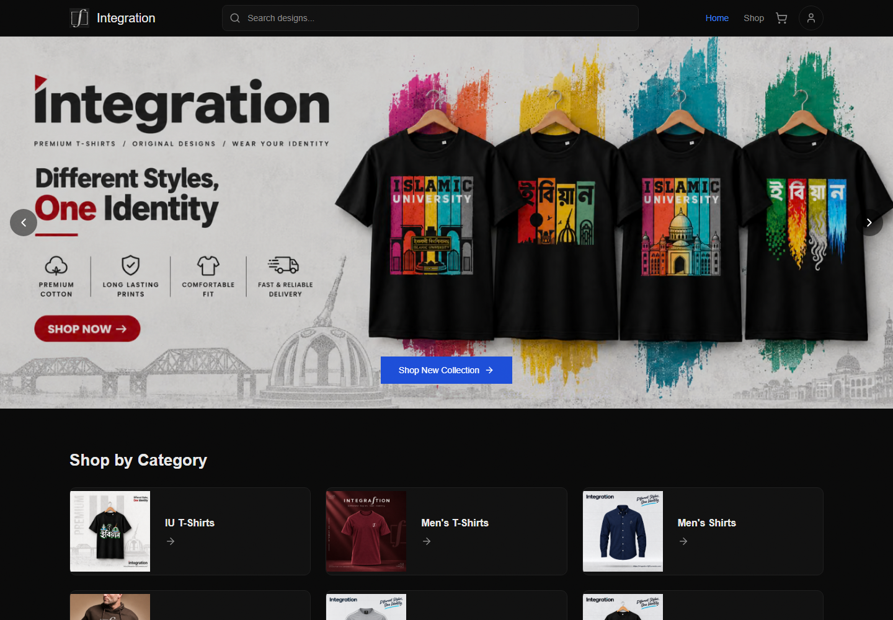
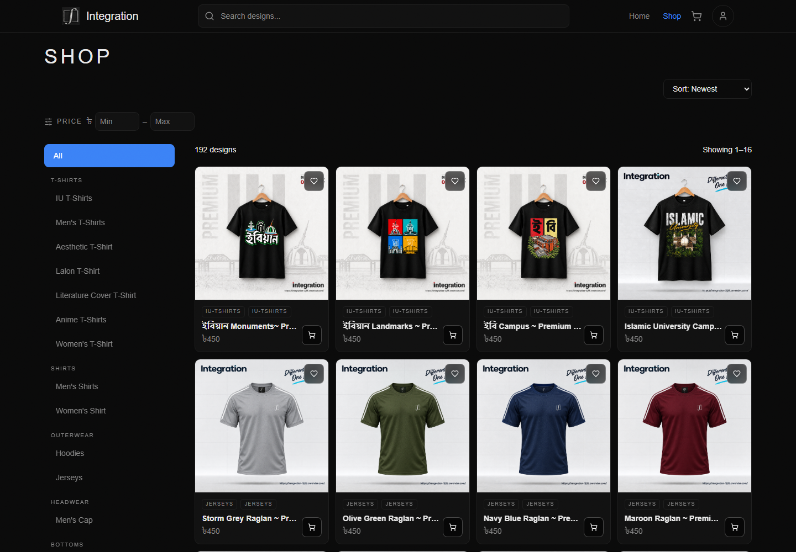
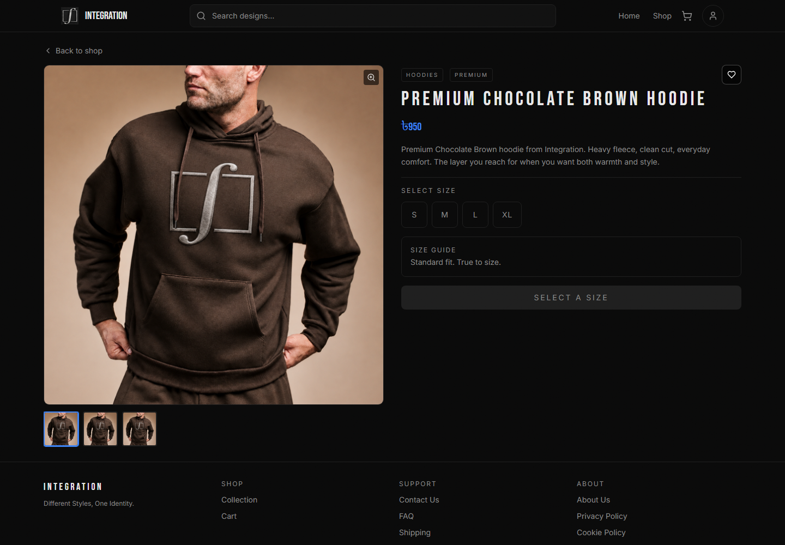
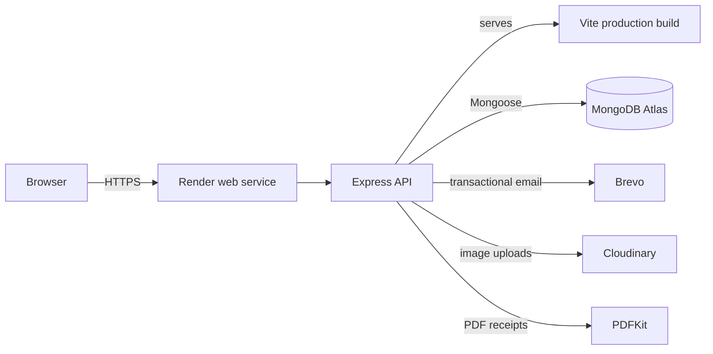

# Integration

**A production MERN e-commerce storefront for an independent streetwear label — built end to end, deployed, and maintained.**

[](https://github.com/NajmosSalahin/Integration/actions/workflows/ci.yml)
[](https://github.com/NajmosSalahin/Integration/actions/workflows/codeql.yml)
[](LICENSE)
[](.nvmrc)

[Live store](https://integration-06n2.onrender.com) · [Architecture](docs/ARCHITECTURE.md) · [Case study](docs/CASE_STUDY.md) · [Development guide](docs/DEVELOPMENT.md)

---

Integration is a full-stack storefront for a small t-shirt and streetwear business in Bangladesh. It covers the entire customer journey - browsing, search, cart, checkout, manual mobile-money payment, order tracking - plus a permission-aware admin workspace for running the store day to day.

> **Sanitized portfolio mirror.** The live store deploys from a private production repository, not from this one. This public repository is a sanitized mirror kept for code review and portfolio purposes. Production secrets, customer data, the real catalog, and internal operations docs stay private, and the demo seed here uses generic products and local SVG artwork so the app can run from a fresh clone without any external media account.

## Screenshots

| Storefront | Shop | Product detail |
|---|---|---|
|  |  |  |

## What it does

### Storefront

- **Curated home page** with an autoplaying, swipeable banner carousel, category grid, featured carousel, and homepage collection
- **Catalog** with server-side search, tag filters, sorting, pagination, and a client-side fuzzy search fallback
- **Product detail** with image gallery, size selection, per-size stock state, wishlist, and related products
- **Cart and checkout** with saved addresses, delivery zones, coupon validation, order notes, and manual payment methods (bKash, Nagad, Rocket, cash on delivery)
- **Accounts** with email verification, login, refresh-token sessions, password reset, profile editing, avatar upload, address book, order history, and order detail pages
- **Content pages** for about, contact, FAQ, shipping, returns, payments, privacy, cookies, and terms
- **SEO** with server-rendered title/description/canonical tags for crawlers, JSON-LD product data, `sitemap.xml`, `robots.txt`, and `llms.txt`

### Admin workspace

- Permission-scoped sections: orders, products, coupons, banners, categories
- Dashboard with status counts and the latest orders
- Order management with status transitions, customer contact shortcuts, and PDF receipts
- Product management with image uploads, per-size stock editing, featured/homepage flags, and activation
- Coupon management with usage limits, expiry, minimum order value, and per-user redemption tracking
- Banner and category management with ordering and homepage visibility

### Platform

- JWT access tokens (10 minutes, held in memory) and rotating refresh tokens (7 days, `httpOnly` cookies)
- Server-side sessions with token-family revocation on password change/reset
- bcrypt password hashing, Zod validation on every mutating endpoint, Helmet, CORS allowlisting, and layered rate limits
- Coupon reservation flow that prevents double-spending under concurrent checkouts
- Brevo transactional email (verification, password reset, order confirmation, owner notification, contact form)
- Cloudinary uploads for product and banner imagery
- Render Blueprint deployment with a single web service serving the built SPA and the API
- Node's built-in test runner, GitHub Actions CI, CodeQL, gitleaks, and Dependabot

## Tech stack

| Layer | Tools |
|---|---|
| Frontend | React 19, Vite 6, React Router 7, TanStack Query 5, Zustand 5, Tailwind CSS 4, Framer Motion 12, lucide-react, Fuse.js |
| Backend | Node 22, Express 4, Mongoose 8, Zod 4, JWT, bcrypt, Helmet, express-rate-limit, Multer, PDFKit |
| Data | MongoDB Atlas |
| Integrations | Brevo (email), Cloudinary (media) |
| Deployment | Render (single web service), GitHub Actions |
| Testing | Node `node:test` with mocked request/response objects |

## Architecture



The client is a single-page app. In production, Express serves the built `client/dist` assets and falls back to `index.html` for client-side routes. The same server renders route-specific SEO tags and JSON-LD into the HTML shell so crawlers see real metadata before JavaScript runs.

See [docs/ARCHITECTURE.md](docs/ARCHITECTURE.md) for the request lifecycle, auth model, data model, and design trade-offs.

## Repository layout

```text
Integration/
├── client/                 React SPA
│   ├── public/             Static assets, demo artwork, SEO files
│   └── src/
│       ├── api/            Fetch wrappers per resource
│       ├── components/     Shared UI and storefront sections
│       ├── pages/          Route components (including admin/)
│       ├── stores/         Zustand cart state
│       └── lib/            Formatting, SEO, search, permissions
├── server/                 Express API
│   ├── controllers/        Route handlers
│   ├── emails/             Brevo templates
│   ├── middleware/         Auth, validation, rate limits, uploads
│   ├── models/             Mongoose schemas
│   ├── routes/             Route definitions
│   ├── scripts/            Admin CLI
│   ├── tests/              node:test suites
│   └── utils/              Tokens, sessions, coupons, PDF, demo seed
├── docs/                   Architecture, case study, screenshots
├── render.yaml             Render Blueprint
└── CHANGELOG.md            Release history
```

## Getting started

### Prerequisites

- Node.js 22 or newer
- npm 10 or newer
- A MongoDB database (Atlas free tier or local MongoDB)

### Install

```bash
git clone https://github.com/NajmosSalahin/Integration.git
cd Integration
npm install
cd client && npm install
cd ../server && npm install
cd ..
```

### Configure

Copy the example environment file to the repository root:

```bash
cp .env.example .env.development
```

Fill in at minimum:

```env
MONGO_URI=mongodb://127.0.0.1:27017/integration
JWT_SECRET=<64 random characters>
JWT_REFRESH_SECRET=<different 64 random characters>
CLIENT_URL=http://localhost:5173
```

Generate secrets with:

```bash
node -e "console.log(require('crypto').randomBytes(48).toString('hex'))"
```

Email and Cloudinary are optional for local development. Without them, the server logs email payloads instead of sending and the demo seed uses local SVG assets.

### Seed demo data

```bash
npm run seed
```

This inserts eight generic products, four categories, and three local banner images. It refuses to run when `NODE_ENV=production` unless `--force` is passed, and it will not overwrite existing products unless you run `npm run seed -- --reset`.

### Run

```bash
npm run dev
```

- Client: <http://localhost:5173>
- API: <http://localhost:5000>
- Health: <http://localhost:5000/api/health>

The Vite dev server proxies `/api` to the Express server.

### Create an admin

```bash
cd server
npm run make:admin -- you@example.com --password "a-long-unique-password" --permissions orders,products,coupons,banners,categories
```

The password must be at least 12 characters. Pass `--prod` to use `.env.production`.

## Environment variables

| Variable | Required | Purpose |
|---|---|---|
| `MONGO_URI` | Yes | MongoDB connection string |
| `JWT_SECRET` | Yes | Access-token signing key |
| `JWT_REFRESH_SECRET` | Yes | Refresh-token signing key |
| `CLIENT_URL` | Yes | Public origin used in emails, SEO, and CORS |
| `PORT` | No | API port, default `5000` |
| `NODE_ENV` | No | `development` or `production` |
| `OWNER_EMAIL` | Yes | Where order and contact notifications go |
| `FROM_EMAIL` | No | Verified Brevo sender; falls back to `OWNER_EMAIL` |
| `WHATSAPP_NUMBER` | No | Store WhatsApp number for customer contact links |
| `MESSENGER_PAGE` | No | Facebook page ID or URL for Messenger links |
| `BREVO_API_KEY` | No | Enables transactional email |
| `BREVO_NEWSLETTER_LIST_ID` | No | Brevo list for newsletter signups |
| `CLOUDINARY_CLOUD_NAME` | No | Cloudinary cloud for uploads |
| `CLOUDINARY_API_KEY` | No | Cloudinary API key |
| `CLOUDINARY_API_SECRET` | No | Cloudinary API secret |
| `TRUST_PROXY_HOPS` | No | Reverse-proxy hops, `1` on Render |
| `ALLOW_ADMIN_BOOTSTRAP` | No | Must be `true` to enable the optional first-run admin bootstrap |
| `ADMIN_BOOTSTRAP_EMAIL` | No | Comma-separated admin emails for first-run bootstrap |
| `ADMIN_BOOTSTRAP_PASSWORD` | No | Bootstrap password, minimum 12 characters |
| `ADMIN_BOOTSTRAP_PERMISSIONS` | No | Comma-separated admin sections |

Never commit real values. `.env*` files are gitignored.

## Scripts

| Command | What it does |
|---|---|
| `npm run dev` | Run client and server together |
| `npm run dev:client` | Run Vite only |
| `npm run dev:server` | Run Express with `--watch` |
| `npm run build` | Build the client for production |
| `npm start` | Start the production server |
| `npm run seed` | Seed generic demo products, categories, and banners |
| `npm test` | Run the server test suite |

## Testing

```bash
npm test
```

The server suite uses Node's built-in test runner with mocked request and response objects. It covers:

- JWT middleware and session rotation, including the refresh grace window
- Config validation and environment loading
- Rate limiting and request validation
- Coupon reservations and order status transitions
- Email verification and verified-email guards
- Origin allowlisting and proxy trust
- Health payload/version consistency

The client build is the frontend check in CI. Run `npm run build` before opening a pull request.

## Deployment

The included [render.yaml](render.yaml) defines a single Render web service:

- **Build:** install root, client, and server dependencies, build the client, then install server dependencies
- **Start:** `cd server && node server.js`
- **Health check:** `/api/health`

Set the environment variables in the Render dashboard. `JWT_SECRET` and `JWT_REFRESH_SECRET` can be generated by Render; database, email, and media credentials should be supplied manually. The Blueprint intentionally contains no secret values.

## Security notes

- Access tokens are short-lived and held in memory on the client; refresh tokens are `httpOnly`, `sameSite`, and rotated on every use
- Refresh-token reuse outside the grace window revokes the whole token family
- Password changes and resets revoke all sessions for that user
- Admin routes require both authentication and the relevant section permission
- All mutating endpoints validate input with Zod
- A global API limiter plus dedicated limits on login, signup, refresh, contact, newsletter, coupon, and order endpoints
- Product and banner uploads are restricted by type and size
- CI runs gitleaks on every push and pull request; CodeQL and Dependabot are enabled
- The public repository contains no production credentials, customer records, or private catalog data

If you find a vulnerability, please follow [SECURITY.md](SECURITY.md).

## Design decisions

A few choices worth calling out:

- **One Render service instead of two.** The API serves the built SPA, which keeps deployment and CORS simple for a small store. The trade-off is that frontend and backend deploy together.
- **Manual payments, explicit state.** Mobile-money payments are confirmed by an admin rather than a gateway webhook. Order status transitions are validated server-side so the UI cannot skip states.
- **Server-rendered SEO for a SPA.** Instead of adding a meta-framework, the Express fallback injects route-specific tags and JSON-LD into the built HTML shell. This keeps the SPA architecture while giving crawlers useful HTML.
- **Coupon reservations.** Checkout reserves a coupon before creating the order and releases it on failure, which avoids the classic double-redemption race without a payment gateway.
- **A demo seed, not the real catalog.** The public repo ships generic products so the app is runnable without exposing the business's actual designs or supplier data.

More detail in [docs/CASE_STUDY.md](docs/CASE_STUDY.md).

## License

Source code is licensed under the [PolyForm Noncommercial License 1.0.0](LICENSE). You may read, study, and use it for noncommercial purposes. Commercial use, resale, or running a competing store with this code is not permitted.

The Integration name, logo, product artwork, photography, and brand assets are **not** covered by the code license. See [TRADEMARK.md](TRADEMARK.md).

## Author

**Najmos Salahin**

- GitHub: [@NajmosSalahin](https://github.com/NajmosSalahin)
- Live store: [integration-06n2.onrender.com](https://integration-06n2.onrender.com)

If you are reviewing this for a role, the [case study](docs/CASE_STUDY.md) covers the problem, the build, the trade-offs, and what I would do next.
