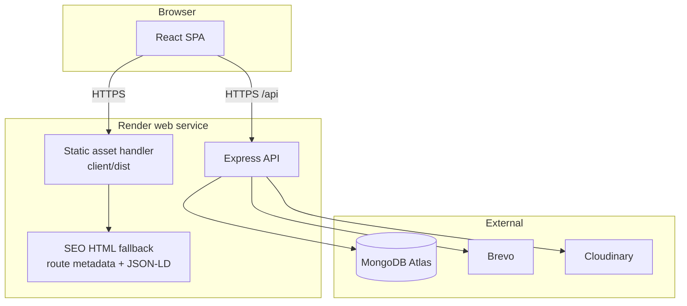
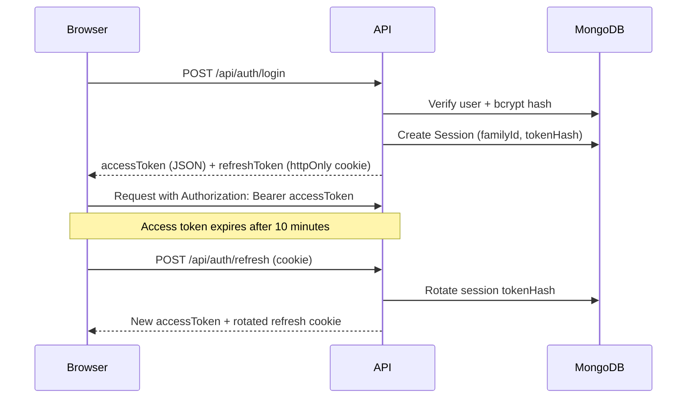
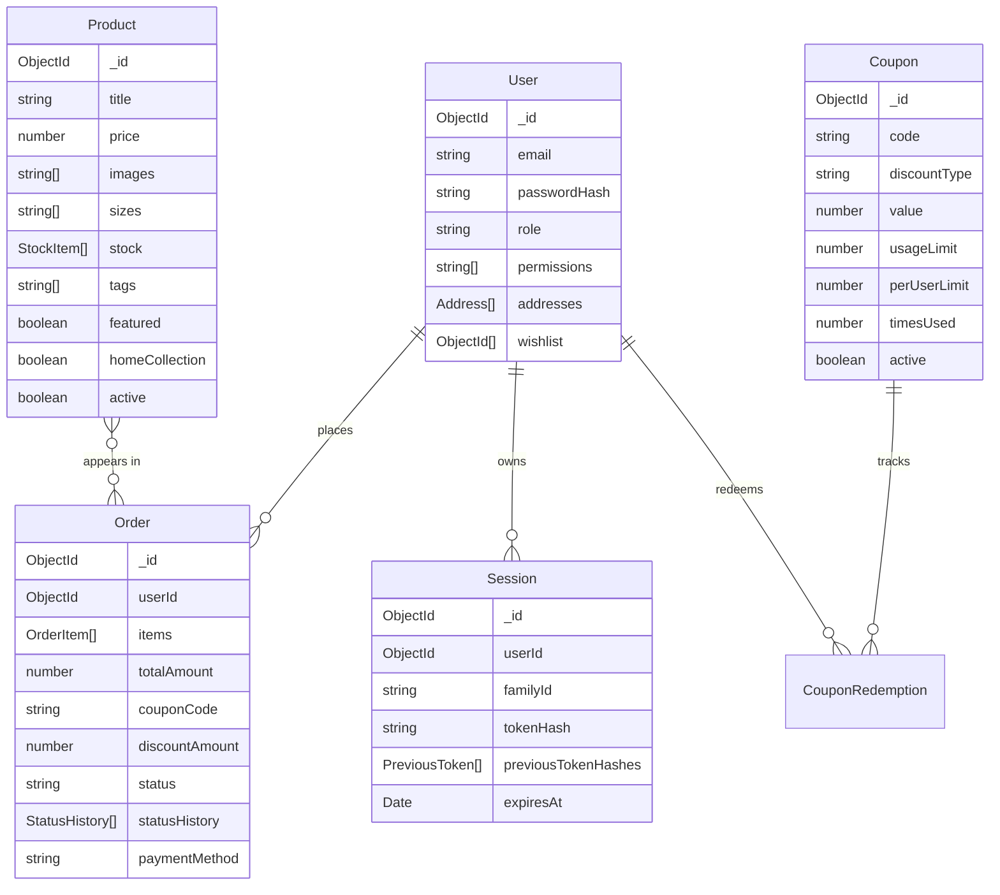

# Architecture

Integration is a two-package MERN application: a React single-page client and an Express API backed by MongoDB. This document explains how the pieces fit together and why the main decisions were made.

## Runtime topology

In development the client runs on Vite at `localhost:5173` and proxies `/api` to Express at `localhost:5000`. In production a single Render web service builds the client and serves `client/dist` through Express. There is no separate frontend host, so there is no cross-origin request in production and no second deploy target to keep in sync.

## Request lifecycle

1. A request for a static file is served from `client/dist` with long-lived immutable caching for hashed assets and `no-cache` for the HTML shell.
2. A request for `/api/*` is matched by the Express router. Unknown API paths return `404` and never fall through to the SPA.
3. Any other request returns the built `index.html`. For known public routes, product pages, and a small noindex list, Express injects the correct title, description, canonical URL, and JSON-LD before sending the shell.
4. Once the shell loads, React Router takes over. TanStack Query fetches API data and caches it per resource.

This gives crawlers real HTML metadata without adopting a meta-framework or running a Node render pass on every request.

## Authentication and sessions

Key properties:

- Access tokens live in memory on the client and are sent as a bearer token.
- Refresh tokens are stored in an `httpOnly` cookie and hashed in the `Session` collection.
- Each login creates a token family. Rotation keeps the previous hash for a 30-second grace window so two tabs refreshing at once do not log the user out.
- Reuse of a token outside the grace window deletes the whole family, which is the standard refresh-token reuse defence.
- Password changes and resets call `revokeAllSessions`, so a stolen session cannot outlive a password reset.
- Admin authorization checks both `role === 'admin'` and the relevant section permission (`orders`, `products`, `coupons`, `banners`, `categories`). An admin with an empty permissions array is treated as a super-admin for backwards compatibility.

## Data model

Order items snapshot `title`, `size`, `quantity`, and `priceAtOrder` at checkout. Later product edits do not rewrite order history.

## API surface

All routes are under `/api`.

| Group | Routes |
|---|---|
| Auth | `POST /auth/signup`, `/login`, `/logout`, `/refresh`, `/verify-email`, `/resend-verification`, `/forgot-password`, `/reset-password`; `GET/PATCH /auth/me`; `PATCH /auth/password`; `POST /auth/avatar`; `PATCH /auth/wishlist`; address CRUD under `/auth/addresses` |
| Products | `GET /products`, `GET /products/:id`, admin CRUD, stock toggle, active/featured/homepage flags |
| Orders | `POST /orders`, `GET /orders/mine`, `GET /orders/:id`, admin list and status updates |
| Coupons | `POST /coupons/validate`, admin CRUD |
| Banners | `GET /banners`, admin CRUD |
| Categories | `GET /categories`, admin CRUD |
| Contact | `POST /contact` |
| Newsletter | `POST /newsletter/subscribe` |
| Uploads | `POST /uploads/image` |
| Health | `GET /health` |

Mutating routes run Zod validation after authentication and permission checks. Object IDs are validated before hitting Mongoose.

## Checkout and coupons

Checkout is intentionally gateway-free: the customer chooses bKash, Nagad, Rocket, or cash on delivery, sends the payment manually, and an admin confirms the order. The server still enforces the important invariants:

- Prices and stock are resolved from the database, not trusted from the client.
- Coupons are validated for active state, expiry, minimum order value, global usage limit, and per-user limit.
- A coupon is reserved before the order is created and released if order creation fails. This avoids two concurrent checkouts both consuming the last use.
- Status transitions are checked against an explicit state machine, so an order cannot jump from `pending_payment` to `delivered` without the allowed intermediate states.

## Frontend structure

- `src/api/` contains one small fetch wrapper per resource. `authFetch` attaches the in-memory access token and retries once after a refresh.
- `src/stores/cart.js` is Zustand with persistence; the cart is client-owned until checkout.
- TanStack Query owns server state. Query keys are resource-based (`products`, `categories`, `orders`, `admin-*`) so mutations can invalidate precisely.
- `src/lib/permissions.js` mirrors the server's section permissions for navigation, while the server remains the source of truth.
- Admin pages live under `src/pages/admin/` and render inside `AdminLayout`, separate from the storefront chrome.

## SEO

- `server/seo.js` builds route metadata, product JSON-LD, and the static route table.
- `server/server.js` reads the built `index.html` once and injects metadata per request in production.
- `GET /sitemap.xml` lists static pages plus every active product.
- `client/public/robots.txt`, `llms.txt`, and `llms-full.txt` describe the public site to crawlers and language models.
- Product pages expose canonical URLs and Open Graph data; private routes are marked `noindex`.

## Media and email

- Uploads go through Multer, are type/size checked, then streamed to Cloudinary. The API stores only the resulting URL/public ID.
- The demo seed uses local SVG assets under `client/public/demo/`, so no Cloudinary account is needed to run the project.
- Brevo templates are plain functions that return HTML strings. If `BREVO_API_KEY` is missing, the server logs a development message instead of failing the request.
- `FROM_EMAIL` falls back to `OWNER_EMAIL`, so a single verified sender is enough for a small store.

## Operational choices

- **Single service.** One Render web service is cheaper and simpler than separate frontend/backend services. The cost is coupled deploys.
- **Free-tier constraints.** MongoDB Atlas M0 has no point-in-time recovery, so the private production repo keeps an encrypted daily `mongodump` workflow. That workflow is intentionally not part of this public repository.
- **No payment gateway.** Manual mobile-money confirmation matches how the business actually operates and avoids gateway fees and integration complexity. The order state machine and audit trail keep it accountable.
- **No microservices.** The domain is small enough that a modular Express app is easier to reason about than separate services.

## Failure modes

- If MongoDB is unavailable, the API starts without a database connection and product endpoints return a service-unavailable response instead of crashing the process. `/api/health` remains available for Render.
- If Brevo is unavailable or unconfigured, order creation still succeeds; email failures are logged.
- If Cloudinary is unavailable, existing image URLs keep working; only new uploads fail.
- If a refresh token is replayed after the grace window, the session family is revoked and the user must log in again.

## Future work

- Automated payment gateway (SSLCommerz or bKash PGW)
- Shipping carrier tracking numbers
- Product reviews and ratings
- Separate development and production databases
- Structured logging and uptime alerting
- End-to-end browser tests for checkout and admin flows
